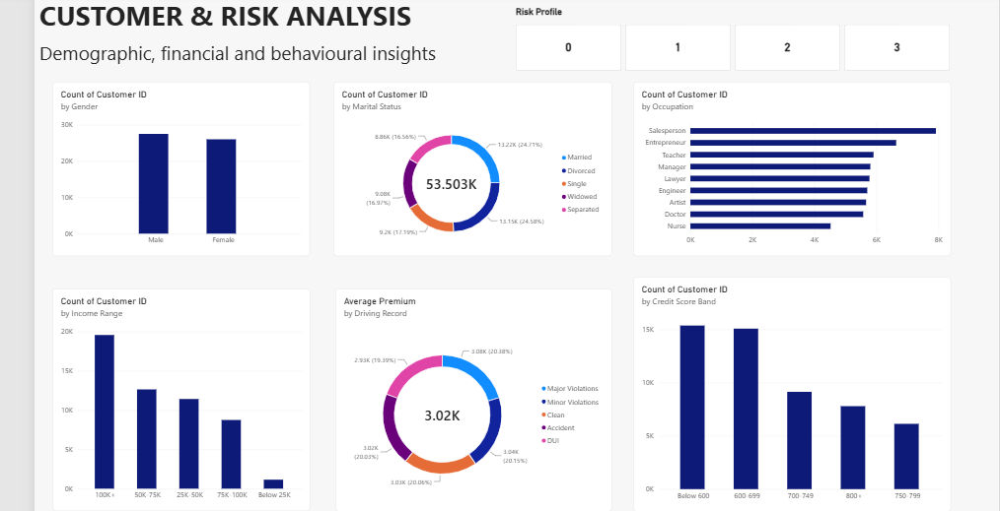

# Insurance Customer & Risk Analytics

An end-to-end data analytics project exploring insurance customer demographics, risk profiles, policy economics, premiums, coverage, and claims using **Microsoft Excel, MySQL, and Power BI**.

## Project Overview

This project analyses a dataset of **53,503 insurance customers** to examine customer distribution patterns, compare policy performance, and explore relationships between customer characteristics and insurance premiums.

The project follows an end-to-end analytical workflow, from data validation and exploratory analysis to SQL-based business queries and interactive Power BI dashboards.

## Tools & Technologies

- **Microsoft Excel:** Data validation, exploratory data analysis (EDA), PivotTables, KPI calculations, charts, and dashboard creation.
- **MySQL:** Data querying, aggregation, conditional categorisation, subqueries, window functions, and Common Table Expressions (CTEs).
- **Power BI:** DAX measures, calculated columns, custom sorting, interactive slicers, and multi-page dashboard development.

## Project Workflow

### 1. Excel — Exploratory Data Analysis & Dashboard

- Reviewed data quality, including missing values and duplicate records.
- Calculated key metrics such as total customers, total premiums, average premiums, and total and average coverage.
- Used PivotTables to analyse risk profiles, policy types, occupations, locations, age groups, and previous claims.
- Created charts and an interactive-looking dashboard layout to communicate key customer and policy patterns.
- Documented the main findings in an insights sheet.

### 2. SQL — Business Analysis Using MySQL

Used SQL to answer business questions and analyse customer and policy characteristics.

Key analyses included:

- Customer profiling by gender, marital status, occupation, education, geography, and age group.
- Customer segmentation using `CASE WHEN`.
- Cross-analysis of risk profiles, demographics, policy types, and claims history.
- Policy economics using `COUNT()`, `SUM()`, and `AVG()`.
- Subqueries to compare premiums with the overall average.
- Window functions using `RANK()` and `PARTITION BY`.
- CTEs to structure multi-step analytical queries.

### 3. Power BI — Interactive Dashboards

Developed a three-page Power BI report to present customer, risk, and financial insights.

- **Page 1 — Executive Overview:** Key performance indicators, risk profile distribution, policy mix, average premium by age group, and previous-claims patterns.
- **Page 2 — Customer & Risk Analysis:** Customer demographics, income ranges, driving records, and credit-score analysis.
- **Page 3 — Policy & Financial Analysis:** Policy premiums, coverage, previous claims, income, age groups, and premium-versus-coverage relationships.

Interactive slicers allow users to filter the analysis by policy type or risk profile.

## Key Findings

- **Customer base:** The dataset contains 53,503 customers.
- **Risk profile distribution:** Risk Profile 3 is the largest coded group, with 16,647 customers (31.1%). Risk Profile 2 is the smallest, with 10,058 customers (18.8%).
- **Policy mix:** Group policies represent the largest policy category, with 18,255 customers (34.1%).
- **Age distribution:** Customers aged 56+ form the largest age group, with 14,801 customers (27.7%).
- **Previous claims and premiums:** Average premium increases modestly across the recorded previous-claims categories, from approximately 2,993 for category 0 to 3,063 for category 3.
- **Policy premiums:** Group policies generate the largest total premium, approximately 55.6 million in the dataset.

These are descriptive findings from the available data. They do not establish causation, and coded risk profiles should not be interpreted as specific risk levels without documented definitions.

## Power BI Dashboard Previews

### Page 1 — Executive Overview

### Page 2 — Customer & Risk Analysis

### Page 3 — Policy & Financial Analysis

## Repository Contents

| File | Description |
|---|---|
| `Insurance_Risk_Analytics.xlsx` | Excel workbook containing analysis, PivotTables, dashboards, and insights |
| `insurance_risk_analytics.sql` | SQL queries organised around business questions |
| `Insurance_Risk_Analytics.pbix` | Power BI report file |
| `powerbi_page1.png` | Executive Overview dashboard screenshot |
| `powerbi_page2.png` | Customer & Risk Analysis dashboard screenshot |
| `powerbi_page3.png` | Policy & Financial Analysis dashboard screenshot |

## Skills Demonstrated

- Data validation and exploratory data analysis
- Excel PivotTables, KPI calculations, and dashboard design
- SQL aggregation, segmentation, and business analysis
- Subqueries, window functions, and CTEs
- DAX measures and calculated columns
- Data visualisation and interactive dashboard development
- Analytical interpretation and business insight communication

## Note on Interpretation

This project presents descriptive analysis based on the variables and categories available in the dataset. The findings should not be treated as verified actuarial conclusions or evidence of causal relationships.

