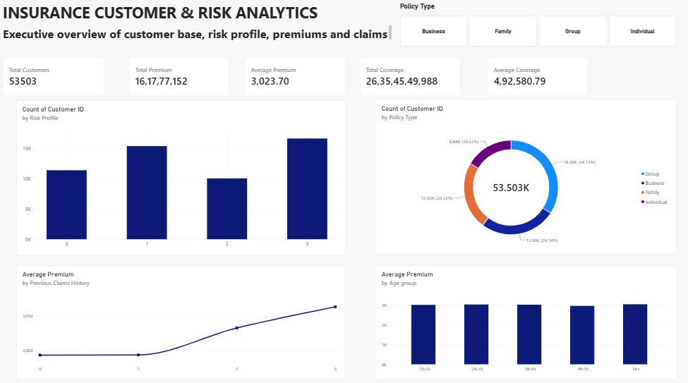
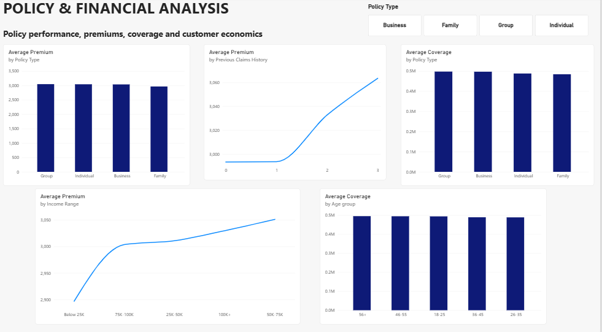

# Insurance Customer & Risk Analytics

An end-to-end data analytics project exploring insurance customer demographics, risk profiles, policy economics, premiums, coverage, and claims using **Excel, MySQL, and Power BI**.

## Project Overview

This project analyses a dataset of **53,503 insurance customers** to identify customer distribution patterns, compare policy performance, and explore relationships between customer characteristics and insurance premiums.

The workflow combines Excel-based exploratory analysis, SQL-driven business queries, and interactive Power BI dashboards to turn data into meaningful business insights.

## Tools & Technologies

- **Microsoft Excel:** Data validation, exploratory data analysis (EDA), PivotTables, charts, KPI calculations, and dashboard creation.
- **MySQL:** Data querying, aggregation, conditional categorisation, subqueries, window functions, and Common Table Expressions (CTEs).
- **Power BI:** DAX measures, calculated columns, custom sorting, interactive slicers, and multi-page dashboards.

## Project Workflow

### 1. Excel — Data Analysis & Dashboard

- Reviewed data quality and checked for missing values and duplicates.
- Calculated total customers, total premiums, average premiums, and coverage.
- Used PivotTables to analyse risk profiles, policy types, occupations, locations, age groups, and previous claims.
- Built a dashboard to present key performance indicators and customer patterns.
- Documented findings in an insights sheet.

### 2. SQL — Business Analysis

Used MySQL to answer business questions through:

- Customer profiling by gender, marital status, occupation, education, geography, and age.
- Customer segmentation using `CASE WHEN`.
- Cross-analysis of risk profiles, demographics, policy types, and claims history.
- Policy analysis using `SUM()`, `AVG()`, and `COUNT()`.
- Subqueries to compare premiums with overall averages.
- Window functions using `RANK()` and `PARTITION BY`.
- CTEs to structure multi-step analytical queries.

### 3. Power BI — Interactive Dashboards

The Power BI report contains three pages:

- **Executive Overview:** Customer KPIs, risk profile distribution, policy mix, age-group premiums, and claims patterns.
- **Customer & Risk Analysis:** Demographic, income, driving-record, and credit-score analysis.
- **Policy & Financial Analysis:** Policy premiums, coverage, claims history, income, age groups, and premium-versus-coverage relationships.

Interactive slicers allow users to filter the dashboards by policy type or risk profile.

## Key Findings

- **Customer base:** 53,503 customers.
- **Risk profile distribution:** Risk Profile 3 is the largest coded group, with 16,647 customers (31.1%); Risk Profile 2 is the smallest, with 10,058 (18.8%).
- **Policy mix:** Group policies form the largest policy category, with 18,255 customers (34.1%).
- **Age distribution:** Customers aged 56+ form the largest age group, with 14,801 customers (27.7%).
- **Previous claims and premiums:** Average premium increases modestly across the recorded claims categories, from approximately 2,993 for category 0 to 3,063 for category 3.
- **Policy premiums:** Group policies generate the largest total premium, approximately 55.6 million in the dataset.

These findings describe patterns in the available data; they do not establish causation or imply a specific risk level without documented definitions.

## Power BI Dashboard Previews

### Page 1 — Executive Overview

### Page 2 — Customer & Risk Analysis

### Page 3 — Policy & Financial Analysis

## Repository Contents

- `Insurance_Risk_Analytics.xlsx` — Excel workbook containing analysis, dashboards, and insights.
- `insurance_risk_analytics.sql` — SQL queries organised around business questions.
- `Insurance_Risk_Analytics.pbix` — Power BI report file.
- `powerbi_page1.png.png`, `powerbi_page2.png.png`, `powerbi_page3.png.png` — Dashboard screenshots.

## Skills Demonstrated

Excel PivotTables · Exploratory Data Analysis · MySQL · SQL aggregation · Subqueries · Window functions · CTEs · DAX · Data visualisation · Interactive dashboards · Business insight communication

## Note on Interpretation

This is a descriptive analysis based on the variables and categories available in the dataset. Findings should not be interpreted as verified actuarial conclusions.
